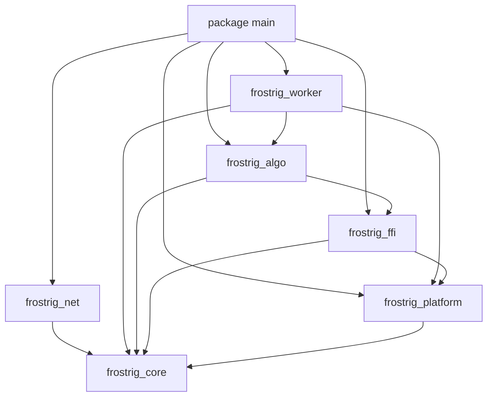

# frostrig 工程骨架

Feature Name: 2026-11-08-engineering-skeleton
Updated: 2026-11-08

## Description

本设计把 frostrig 落成可编译的 Odin 多包骨架。目标是固定包边界、公共契约、算法注册表、平台大页真实分配、FFI 句柄、worker 队列与线程池骨架、Stratum 空过程，以及 main 组装。哈希计算与 Stratum 协议解析不在本阶段。

## Architecture

依赖方向单向向下，编译期禁止环。



目录与 package 一一对应：

```text
frostrig/
├── main.odin
├── core/
├── algo/
├── worker/
├── platform/
├── ffi/
└── net/
```

导入点一律显式别名，例如 `import core "./core"`。包标识符使用 `frostrig_` 前缀，避免与 Odin core 集合冲突。

## Components and Interfaces

### frostrig_core

职责：跨包类型、错误、生命周期。禁止导入同级包。

文件：

- `core/error.odin`：`Error`
- `core/types.odin`：作业、份额、配置、哈希缓冲
- `core/lifecycle.odin`：`Lifecycle`、`Lifecycle_Hooks`

### frostrig_algo

职责：算法元数据与函数指针表。禁止 `foreign import`。

对外过程：

- `register(entry: Algo_Entry) -> Error`
- `lookup(id: Algo_Id) -> (Algo_Entry, bool)`
- `lookup_by_name(name: string) -> (Algo_Entry, bool)`
- `count() -> int`

`Algo_Hash_Proc` 仅作为指针类型存在；本阶段不挂真实哈希。

### frostrig_platform

职责：操作系统交互。`core:sys` 只出现在本包的后缀文件。

对外过程：

- `alloc_large_pages(size: uint) -> (ptr: rawptr, ok: bool)`
- `free_large_pages(ptr: rawptr, size: uint)`
- `bind_current_thread_to_cpu(cpu_index: u32) -> Error`
- `get_numa_node_for_current_thread() -> (node: u32, ok: bool)`

大页分配为真实系统调用：

- Linux：`memory_linux.odin` 调用 `mmap`，flags 包含匿名映射与 huge page 标志；size 按 2 MiB 对齐。失败时 `ok=false`。
- Windows：`memory_windows.odin` 调用 `VirtualAlloc`，分配类型包含 `MEM_LARGE_PAGES`。失败时 `ok=false`。
- 释放路径与分配路径成对：Linux `munmap`，Windows `VirtualFree`。

亲和性与 NUMA 本阶段保持骨架返回值。

### frostrig_ffi

职责：唯一允许 `foreign import` 的包。对外只暴露 distinct 句柄。

文件：

- `ffi/handles.odin`：`Rx_Cache`、`Rx_Dataset`、`Rx_Vm`、`Rx_Flags`
- `ffi/randomx.odin`：Odin 风格过程，本阶段返回 `Not_Implemented`
- `ffi/randomx_linux.odin` / `ffi/randomx_windows.odin`：库路径与空 `foreign` 块

`_ptr` 字段仅在 ffi 包内解释。

### frostrig_worker

职责：队列、nonce 切分、线程池生命周期。通过 algo 注册表分发，不调用 C 哈希，不实现 Stratum。

文件：

- `worker/queue.odin`
- `worker/nonce.odin`
- `worker/pool.odin`

### frostrig_net

职责：Stratum 骨架。只依赖 core。`connect` / `login` / `submit` / `close` 返回 `Not_Implemented`。

### package main

职责：显式别名导入并组装。不实现挖矿循环。

## Data Models

```text
Algo_Id, Job_Id, Worker_Id : distinct integer
Nonce : u64
Hash : { bytes: [64]u8, len: u32 }
Algo_Config : { id, huge_pages, full_memory, flags, thread_index }
Job : { id, algo, blob, target, seed, nonce_start, nonce_count }
Share : { job_id, nonce, hash, worker_id }
Miner_Config : { thread_count, huge_pages, cpu_affinity, algo }
Lifecycle : Created | Initialized | Running | Stopping | Stopped
Algo_Entry : { id, name, create, destroy, prepare, hash }
Algo_Handle : { id, ctx }
Rx_Cache / Rx_Dataset / Rx_Vm : distinct struct { _ptr: rawptr }
```

## Correctness Properties

1. **Property 1: 注册表双向查找** — 对任意成功 `register` 的条目，`lookup(id)` 与 `lookup_by_name(name)` 均返回同一 `Algo_Entry`。对应 Requirement 3。
2. **Property 2: nonce 分区覆盖** — 给定 `nonce_start`、`nonce_count`、`thread_count > 0`，各线程子区间互不重叠，并集等于 `[nonce_start, nonce_start + nonce_count)`。对应 Requirement 7。
3. **Property 3: 大页分配配对** — `alloc_large_pages` 返回 `ok=true` 时指针非空；随后 `free_large_pages` 使用同一 size 释放。对应 Requirement 4。
4. **Property 4: 依赖单向** — 源码导入关系构成 DAG，`core` 无同级导入，`net` 无 `algo`/`platform` 导入，`foreign import` 仅出现在 `ffi/`。对应 Requirement 1、6、8。
5. **Property 5: 骨架过程有明确错误** — 未实现的哈希、Stratum、亲和性/NUMA 骨架返回 `Not_Implemented`、`Ffi_Handle_Invalid` 或 `Affinity_Failed`，返回值可区分。对应 Requirement 5、6、8。

## Error Handling

| 场景 | 返回 |
|---|---|
| 注册空名称 | `Invalid_Argument` |
| 重复算法 ID | `Already_Initialized` |
| 查找失败 | `ok=false` |
| 大页 mmap/VirtualAlloc 失败 | `ok=false`，上层映射 `Huge_Pages_Unavailable` |
| 队列满/空 | `Queue_Full` / `Queue_Empty` |
| 空 ffi 句柄 | `Ffi_Handle_Invalid` |
| 哈希/Stratum/NUMA 骨架 | `Not_Implemented` |
| 亲和性骨架 | `Affinity_Failed` |

单个过程不超过 50 行。失败路径立即返回，不做隐式降级到普通页（本阶段大页失败即失败）。

## Test Strategy

实现优先于测试。带 `*` 的测试任务默认可选。

- 单元测试：`Error.None == 0`、注册表重复/查找、队列满空、nonce 切分、ffi/net 骨架返回值
- 属性测试：Property 1、Property 2
- 平台测试：Linux 上调用 `alloc_large_pages`；无大页权限时断言 `ok=false`；有权限时断言指针非空并可释放
- 检查点：`odin check` / `odin build` 验证包可编译与导入方向

## References

[^1]: 会话架构草案 — 七包分层、依赖白名单、core/algo/ffi 类型签名
[^2]: 用户确认 — platform 大页使用真实 mmap/VirtualAlloc；补充 requirements/design
