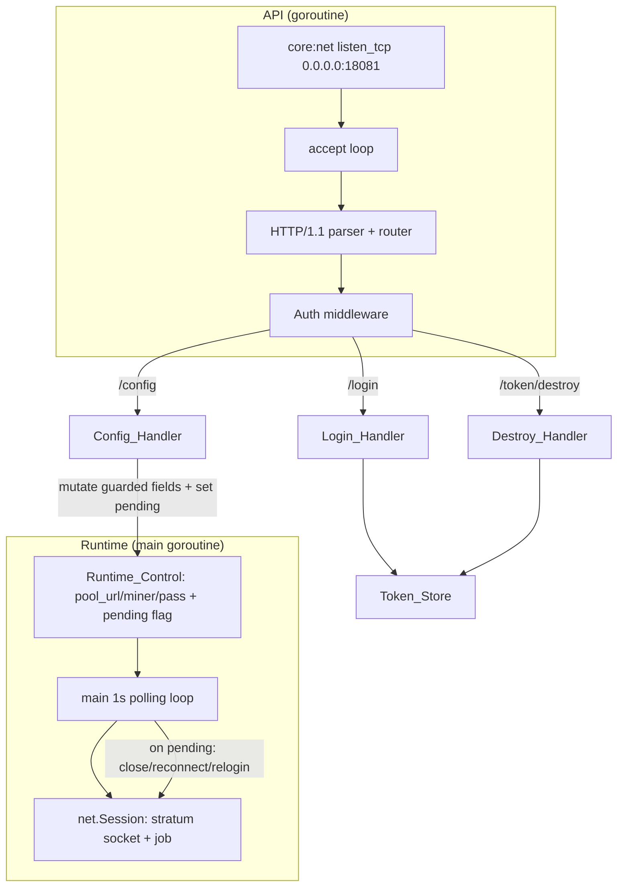

# API Pool Config

Feature Name: api-pool-config
Updated: 2026-11-19

## Description

Frostrig gains a small HTTP/1.1 API (`frostrig-api`) on `0.0.0.0:18081` that
lets an authenticated user change the pool URL and the miner name at runtime.
Access control exempts loopback, non-proxied requests; all other requests must
present a 64-character token verified by SHA-256, expiring in 30 minutes, with
at most one active token. `/login` mints a token from a startup-generated
64-character login key printed to stdout. `/token/destroy` self-destructs the
token account and prints a fresh token to stdout.

## Architecture

The API runs on its own goroutine (via `thread` / `os.thread`). The runtime
mutation is funneled through a small mutex-guarded `Runtime_Control` that the
main mining loop polls once per second, so all network I/O stays on the main
goroutine.

## Components and Interfaces

- `api.Auth_State`: single-slot token store.
  - `login_key_hash: [32]u8` — SHA-256 of the startup login key.
  - `token_hash: [32]u8`, `token_issued: time.Time`, `token_valid: bool`.
  - Methods: `issue_token(now) -> string`, `verify(token, now) -> bool`,
    `destroy(now) -> string` (invalidates and mints a replacement).
- `api.Runtime_Control`: runtime config shared with `main`.
  - `pool_url`, `miner_name`, `password: string` (mutex-guarded).
  - `pending: bool` — set by the config handler, consumed by main.
  - `apply() -> (reconnect: bool)` — reads and clears `pending`.
- `api.handle(conn)`: parses one HTTP/1.1 request and routes it.
  - `is_loopback_noproxied(req) -> bool`: peer address in `127.0.0.0/8`/`::1`
    AND no `X-Forwarded-For`/`Forwarded`/`X-Real-IP`/`Via` header.
- `net`: reuse the existing stratum `core:net` transport for the listener
  (`listen_tcp`/`accept`/`send`/`recv`); the project already links `core:net`.

## Data Models

- `Login_Key`: 64-char string over `0-9a-zA-Z_\-+&`, generated at startup,
  printed to stdout; only its SHA-256 is retained.
- `Token`: 64-char string over the same charset; stored as SHA-256 + issued-at.
- `Config_Update`: `{ pool_url?: string, miner_name?: string }` (JSON).

## Correctness Properties

1. At most one active token at any time (issue invalidates the previous).
2. Tokens expire 30 minutes after issuance.
3. Auth compares SHA-256 digests, never plaintext, for both login key and token.
4. Loopback+non-proxied requests bypass auth; all others require a valid token.
5. Config changes are runtime-only: never written to disk, never leaked across
   a reconnect (the new pool/miner values are the only mutation).

## Error Handling

- `401 Unauthorized`: bad login key, missing/invalid/expired token.
- `400 Bad Request`: malformed JSON, unknown field.
- `404 Not Found`: unknown path.
- All responses are JSON: `{ "ok": bool, "error": string?, "token"?: string }`.

## Test Strategy

- **Unit**: SHA-256 verification, token expiry boundary (29/30/31 min),
  single-session invalidation, self-destruct rotation, loopback vs proxy
  classification (loopback+no-header exempt; loopback+`X-Forwarded-For` not
  exempt; non-loopback not exempt).
- **Integration**: start the API on `127.0.0.1:18081`, exercise `/login` →
  `/config` → `/token/destroy` over a loopback `core:net` client with a known
  login key; assert status codes and that stdout receives a fresh token.
- **Runtime**: apply a `Config_Update` and assert `Runtime_Control.pending` is
  set and the stratum session is re-logged in with the new miner name.
